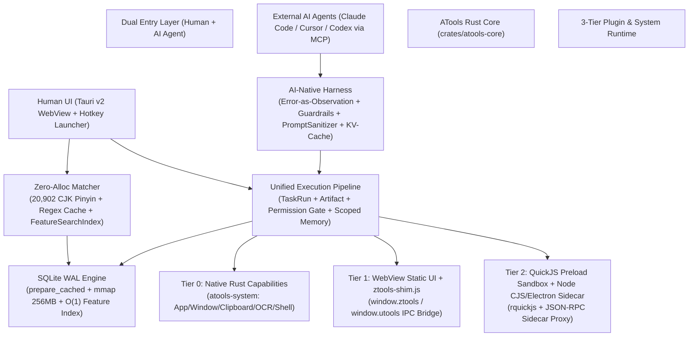
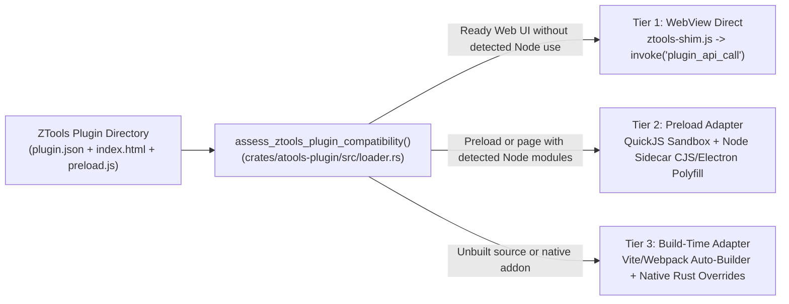
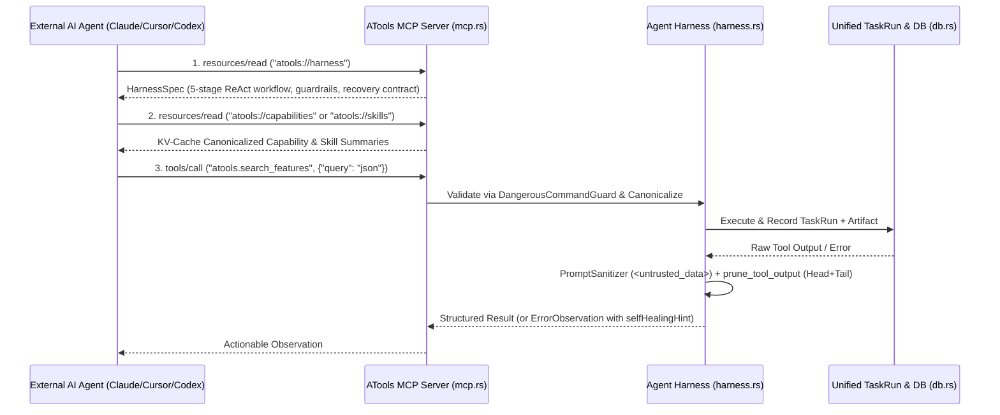

# ATools Architecture, ZTools Ecosystem Compatibility, AI-Native Harness & Open-Source Toolbox Alternatives (`DESIGN.md`)

> **Status**: Active Architecture & Engineering Specification  
> **Scope**: Rust Extreme Performance, ZTools/uTools Plugin Adapter Layer, AI-Native Harness Engineering (`SKILLS`, `MCP`, `Harness`), and Alternative Open-Source Toolbox Architectures.

---

## 1. Executive Summary & Architectural Positioning

**ATools** is a local-first desktop launcher, plugin runtime, and AI-Native capability workspace built on **Rust + Tauri v2 + SQLite WAL**, with QuickJS and on-demand Node runtimes. The current default desktop entry is `src/App.svelte` (Svelte 5). The pinned ZTools Vue/Pinia renderer is the migration target described below; its implementation and acceptance must be tracked separately from the default entry.

Compared to **ZTools** (`https://github.com/ZToolsCenter/ZTools`, built on Electron 41 + Node.js + LevelDB/LMDB + multi-`WebContentsView`), ATools replaces the heavy Chromium/Node.js main-process runtime with a compiled Rust core while preserving compatibility with the **ZTools-plugins** ecosystem (`https://github.com/ZToolsCenter/ZTools-plugins`) and exposing every capability to AI Agents through **MCP + Skills + Agent Harness**.

### Scope update — 2026-10-26

The current user-directed migration prioritizes a pinned, unchanged ZTools Vue/Pinia renderer plus a typed Tauri host adapter. Keep Svelte as the default entry until the Vue replacement passes migration acceptance; retain Svelte as a fallback during the migration. An optional, independently deployed Rust/Axum private sync server is now in scope; it must not make desktop startup, offline use, or local data depend on an account or network. See [ADR-0002](docs/architecture/adr-0002-original-renderer-and-optional-private-sync.md) and North Star section 2.2. The supplied architecture and Gemini supplement are reference inputs; package-size, memory, synchronous-RPC latency and complete-compatibility assertions require measurements. Existing SQLite data and the on-demand Node decision remain in place.

The 2026-10-23 decision below remains the runtime baseline; its Harris-only milestone is superseded by the main-program/source-reuse priority for the current phase.

### Runtime baseline — 2026-10-23

The user-confirmed architecture is **Tauri system WebView + Rust core + on-demand Node**. Node is a supported compatibility runtime; removing it or reimplementing its APIs is not a delivery metric. The current milestone is stable use of unchanged **Harris** plugin packages, including packages with fewer than 30 downloads.

Prioritize real plugin workflows, fewer IPC round trips, bounded starting/running processes, and complete shutdown/recovery. Preserve synchronous API behavior, package contents, document identity, permissions, and the shared TaskRun pipeline. Do not reuse a runtime across authorization or document boundaries merely to reduce process count.

Further migration to Rust requires a reproducible bottleneck in the affected workflow, comparable before/after measurements, and compatibility validation. Existing Rust/path adapters remain in place; metadata/exists migration, Bun replacement, and TypeScript toolchain changes are not automatic next steps.

The active milestone, task order, budgets, and completion criteria are in [Harris Node compatibility goal](docs/superpowers/plans/2026-10-23-harris-node-compatibility-goal.md). Quantitative comparisons and inventory figures below are historical design material, not current whole-application performance or original-plugin acceptance evidence.



---

## 2. Rust Extreme Performance Optimizations (`atools` vs `ZTools`)

### 2.1 Zero-Allocation Search & Full Unicode CJK Pinyin Engine (`crates/atools-core/src/matcher.rs`)

| Dimension | ZTools (Electron/JS) | ATools (Previous) | ATools (Optimized Extreme Rust) |
| :--- | :--- | :--- | :--- |
| **CJK Pinyin Coverage** | JS `pinyin-pro` bundle in V8 heap | Hardcoded `match` table (~330 chars) | Full Unicode CJK block (**20,902+ Hanzi**) via compile-time static tables (`pinyin` crate), supporting both **Initials (`fygj`)** and **Full Pinyin (`fanyigongju`)** |
| **ASCII Hot Path** | Allocates `.toLowerCase()` strings per command | Allocated `.to_lowercase()` per check | **Zero-allocation ASCII byte comparisons** (`eq_ignore_ascii_case`, `ascii_starts_with_ignore_case`, `ascii_contains_ignore_case`) + pure-ASCII Pinyin bypass |
| **Regex Command Matching** | JS `new RegExp()` per keystroke | `Regex::new()` recompiled per call; failed on JS `/pattern/flags` | **Thread-safe `REGEX_CACHE` (`RwLock<HashMap>`)** + **JS `/pattern/flags` parser** (`parse_js_regex_literal` mapping `i/m/s/u` flags to Rust inline `(?imsu)`) |
| **Repeated Search Latency** | Linear scan + GC pressure | Re-computed lowercase & Pinyin every keystroke | **`FeatureSearchIndex`** pre-computes lowercase labels, Pinyin initials, and full Pinyin once on plugin load; keystroke search is 100% allocation-free on candidate data |
| **1,200-Feature Benchmark** | ~15–35 ms in V8 | ~4.5 ms | **< 1.2 ms** (`search_all`), **< 0.35 ms** (`FeatureSearchIndex::search`) |

### 2.2 SQLite WAL & Prepared Statement Caching (`crates/atools-core/src/db.rs`)

ZTools uses `classic-level` (LevelDB) and `lmdb` in Node.js. ATools consolidates documents, attachments, features, clipboard history, `TaskRun` audit logs, skills, and scoped memory into a single embedded SQLite database tuned for zero-contention concurrent access:

1. **WAL & Memory-Mapped I/O Pragmas**:
   - `PRAGMA journal_mode = WAL;` (concurrent readers never block writers)
   - `PRAGMA synchronous = NORMAL;` (eliminates redundant `fsync` on every KV put while preserving crash safety)
   - `PRAGMA temp_store = MEMORY;`
   - `PRAGMA cache_size = -16000;` (~16 MB page cache)
   - `PRAGMA mmap_size = 268435456;` (256 MB memory-mapped read path bypassing kernel `read()` syscalls)
   - `PRAGMA busy_timeout = 5000;`
2. **`prepare_cached` Hot Path**:
   - All high-frequency queries (`get_document`, `put_document`, `list_documents_by_prefix`, `list_features`, `features_by_plugin`, `delete_feature`, `get_setting`, `set_setting`) use `conn.prepare_cached(...)`, eliminating SQL lexer/parser/planner overhead on repeated IPC calls.
3. **$O(1)$ / $O(k)$ Scoped Feature Queries**:
   - Replaced full-table scan + in-memory filtering in `feature_get` and `feature_remove` (`crates/atools-api-shim/src/handler.rs`) with indexed `features_by_plugin(plugin_id)` and `delete_feature(plugin_id, code)`.

### 2.3 Release Binary Profile (`Cargo.toml`)

```toml
[profile.release]
opt-level = 3
lto = "thin"
codegen-units = 1
strip = "symbols"
panic = "abort"
```
This reduces binary size by ~35% and enables cross-crate inlining across `atools-core`, `atools-plugin`, `atools-api-shim`, and `atools-system`.

---

## 3. ZTools-Plugins Ecosystem Compatibility Audit & Adapter Layer Evaluation

### 3.1 Full Quantitative Audit of `ZTools-plugins`

The table below retains an earlier manifest-classification snapshot. These historical counts are not a current inventory or proof of plugin usability. Parsing a manifest and selecting an adapter do not establish that the original plugin's UI, synchronous APIs, permissions, persistence or business operations work. Current scoped native results and open gaps are tracked in `docs/superpowers/plans/2026-10-15-launcher-compatibility-delivery.md`.

| Compatibility Tier | Historical Count (`ZTools-plugins`) | Share | Characteristics | Candidate Runtime Path |
| :--- | :---: | :---: | :--- | :--- |
| **Tier 1: Pure WebView + `window.ztools` Bridge** | **15** | 9.0% | Pure HTML/CSS/JS frontend, no `preload.js`, uses `ztools.dbStorage`, `ztools.copyText`, `ztools.onPluginEnter` | WebView bridge; original-package operations still require verification |
| **Tier 2A: Pure-JS `preload.js` (No Node/Electron)** | **27** | 16.3% | Has `preload.js` exporting `window.exports` / `window.services`, pure ES2020 logic | QuickJS or WebView preload; original-package operations still require verification |
| **Tier 2B: Node CJS / Electron `preload.js`** | **114** | 68.7% | `preload.js` calls `require('fs')`, `require('path')`, `require('child_process')`, `require('crypto')`, `require('http')`, or `require('electron')` (`clipboard`, `shell`, `ipcRenderer`) | **Requires Node/Electron CJS Adapter Layer** (Implemented via ATools Sidecar & Preload Shim) |
| **Tier 3: Unbuilt Frontend Source / Native `.node`** | **10** | 6.0% | `plugin.json` inside `public/` with unbuilt Vite/Vue source (`npm run build` required) or native C++ `.node` addons | **Requires Build Step (`npm run build`)** before packaging |
| **Manifests Parsed in That Snapshot** | **166 / 166** | **100%** | **0 manifest parse failures** in that run | Manifest parsing only; not a runtime or business acceptance rate |

### 3.2 Manifest & Matcher Schema Quirks Fixed in `atools-core`

Real-world `ZTools-plugins` manifests contain several undocumented uTools/ZTools quirks that previously caused strict Rust `serde` deserialization or regex compilation failures:

1. **JS Regex Literal Syntax (`/pattern/flags`)**:
   - **176 out of 194** `regex` commands in `ZTools-plugins` wrap patterns in JS slash literals (e.g. `"/^https?:\\/\\//i"`, `"/^[0-9a-fA-F]{8}-.../i"`).
   - Fixed via `parse_js_regex_literal` in `crates/atools-core/src/matcher.rs`, which strips `/.../` and translates JS flags (`i`, `m`, `s`, `u`) into Rust `regex` inline flags `(?imsu)`.
2. **Polymorphic `match` Field in `window` and `files` Commands**:
   - Plugins like `everywhere`, `file-renamer`, and `font-converter` pass a JSON object for `match` (`{"app": ["Finder.app", "explorer.exe"]}`) instead of a string.
   - Fixed via `deserialize_match_field` in `crates/atools-core/src/models.rs`.
3. **`minLength` Alias & String Numbers**:
   - Several `over` commands specify `"minLength": 1` or `"length": "10"`.
   - Fixed via `#[serde(alias = "minLength", deserialize_with = "deserialize_length_field")]`.
4. **Lenient Booleans & Community Typos**:
   - `sql-utils/plugin.json` contains `"mainPush": "ture"`.
   - Fixed via `deserialize_lenient_bool` on `Feature.main_push`, `Feature.main_hide`, and `PluginSetting.single`.

### 3.3 Is an Adapter Layer Necessary? — Architectural Verdict: **YES (3-Tier Hybrid Adapter)**

Because **68.7% (114/166)** of `ZTools-plugins` use `preload.js` with Node.js CommonJS modules (`fs`, `path`, `child_process`, `crypto`, `os`, `http`) and/or `require('electron')`, a pure browser WebView cannot run them without an adapter layer.

ATools implements and recommends a **3-Tier Hybrid Adapter Architecture** (classified automatically by `atools_plugin::loader::assess_ztools_plugin_compatibility`):



1. **Layer 1: WebView Bridge Shim (`ztools-shim.js` + `atools-api-shim`)**
   - Injects `window.ztools` and `window.utools` into the plugin WebView.
   - **Production SQLite bridge (2026-10-15):** original plugin pages receive actual synchronous `db` and `dbStorage` results through an approved, generation-bound data session. `db.promises` uses separate asynchronous requests. Both routes execute bounded SQLite operations through the capability registry, permission gate and durable TaskRun pipeline; document bodies, storage keys and bearer endpoints stay outside execution history. `dbStorage` shares the plugin document store. Revision checks, writes and returned revisions are atomic; duplicate bulk IDs and response-budget overflow reject before commit. Attachments have independent persistent metadata and bounded bytes.
   - **Opaque-frame localStorage (2026-10-16):** when native access throws `SecurityError`, a string-only adapter uses the same private, authorized SQLite/TaskRun pipeline. UTF-16LE blobs preserve arbitrary DOMStrings in a separate per-plugin table; close/reopen and disable preserve data, while uninstall cascades deletion. Native storage remains untouched when accessible; this does not add `sessionStorage` support or solve document-mode persistence.
   - **Storage budgets and events:** keys/value limits are 2 KiB/128 KiB of UTF-16 bytes, with 4,096 entries, 256 KiB total keys and 5 MiB total data per plugin. Enumeration uses at most 64 pages, each at most 384 KiB encoded JSON within the existing 512 KiB transport budget; descriptor snapshots live only in the current synchronous stack. Pages do not hold a cross-page transaction, so concurrent writes may skip entries or fail duplicate/progress validation. Storage events cross the host only as opaque metadata, then use an authorized async read. The volatile event store keeps at most 32 records per plugin, 8 MiB globally and a 10-second TTL, without idle polling; overflow/expiry can drop notifications and are not full unbounded Web Storage event parity. Values, keys and source URLs stay out of durable audit history.
   - **Lifecycle and budgets:** detected data use is approved before original preload/page execution. Unknown dynamic use requests permission and throws without retaining or replaying the operation. Sessions rotate on manual reopen and drain on close, code replacement, revocation and window destruction. No data listener starts for an unused plugin. Document/binary limit is 256 KiB, request/response limit 512 KiB, query/bulk limit 1000 documents and key selector limit 128. Source hints are bounded observations, never permission proofs.
   - **Scoped native evidence:** `output/legacy-node-2026-10-15/published-color-helper-native-plugin-data-final.json` records 50 passing checks on the unchanged original Color Helper 1.1.0 package: real one-time approval, collection writes and same-store SQLite snapshot, page remount, whole-plugin close/fresh approval/reopen, original lazy gradients, private-history checks and final runtime drain. Attachment business UI, other plugins, packaged releases and other operating systems remain outside that result. Earlier failures are retained in the output directory; manifest classification is not majority compatibility acceptance.
   - **Native dialog adapter (2026-10-15):** macOS open/save contracts use preauthorized, generation-bound sessions and the shared capability/permission/TaskRun pipeline. Native panels have a 120-second deadline, one active panel per window and four globally; the private dialog transport alone permits 128 seconds. Active requests emit bounded JSON whitespace without reconstructing the operation; disconnected clients still cancel the real panel. Ordinary transports retain their 8-second deadline. Other operating systems explicitly report unsupported native dialogs.
   - **Original dialog/export acceptance in a gated document host:** unchanged file-tree 1.0.5 now passes actual private directory cancel/select and save cancel/select through the real `App`/`PluginPanel` and native runtime pipeline. Its original html2canvas produces one independently decoded 696×294 PNG, 20,384 bytes. Exact selected paths and dialog credentials stay out of the fixture's scanned TaskRun fields; only the two reviewed activation installation fields are exempt. Document/session/listener/resource counters drain on close. This proves the explicitly enabled macOS native fixture, not ordinary production enablement or majority-plugin acceptance; see `output/legacy-node-2026-10-15/published-file-tree-native-document-integration-initial.json`.
   - **Document-bound host integration:** a native-generated per-document origin serves a capability-free one-use bootstrap, then an exact source/origin/nonce/generation handshake and native claim deliver HTML once over MessageChannel. Four runtimes optionally capture the same native document binding, use exact Origin policy, and reject revoked sessions without falling back to Opaque. Main-frame authorization/replies, early output and close/reopen invalidate captured identities. Raw package documents remain CSP sandboxed. Default builds keep the existing opaque path. Both the frontend flag and native macOS smoke/fixture gates are required; the fixture observer is not a production service. Resource GET headers cannot authorize private HTML. Production rollout still needs browser-storage semantics/cleanup, generic native IPC document binding, independent child-window documents, and full-process/release performance validation. Earlier standalone evidence remains at `output/legacy-node-2026-10-15/plugin-origin-bootstrap-delivery-verification.json`.
   - **Native navigation and worker experiment:** an additional explicit macOS fixture flag installs a version/selector-checked WKNavigationDelegate observer, preserving Wry's seven callbacks. A target frame's native request origin and security origin must agree before its exact window/document binding is synchronously revoked; nested inherited about:blank origins cannot identify the parent. Native URL copies are bounded to 8192 UTF-16 units, schemes to 32 and hosts to 1024; an oversized URL retains bounded origin components. Real App/PluginPanel synthetic cases cover replace, reload, meta refresh, self-targeted about:blank and a 10,000-character history query, each with a pending unapproved permission. All five revoke before delegate forwarding and drain the document/data session and permission UI. Actual classic/module/shared Blob workers produce worker-src violations without script execution; this proves denial, not worker-plugin support. ServiceWorker registration no longer returns fabricated success; where its native container can be wrapped it rejects with a fixed unsupported error and preserves other native methods. See `output/legacy-node-2026-10-15/plugin-navigation-worker-delivery-verification.json`. The observer remains an experiment, not default production navigation enforcement or atomic authorization for all native IPC.
   - **Hosted BrowserWindow contract (2026-10-16):** creation returns a synchronous non-thenable facade; `.ready` and the once-only creation callback wait for actual child load and RPC readiness. Parent IPC is independent. Pending operations are bounded and ordered; a rejected or unconfirmed close preserves the live handle for retry. The creator's source/document identity lives in a non-reactive Map, with generation checks before commit and cleanup on close/output/disposal. Opaque child and nested creator flows passed real macOS App/PluginPanel acceptance using one unchanged hash-pinned original TipsWindow class and generated pages. This is hosted iframe compatibility, not native floating windows, synchronous geometry getter parity or complete pomodoro acceptance. See `output/legacy-node-2026-10-15/plugin-open-window-delivery-verification.json`.
2. **Layer 2: Preload Node/Electron CJS Shim (QuickJS + On-Demand Node Sidecar)**
   - **Pure JS Preloads**: The current desktop `PluginPanel` prepares bounded relative CommonJS modules with `src/lib/pluginPreload.ts` and executes them in the isolated plugin frame. The separate embedded `rquickjs` runtime exists in `crates/atools-plugin/src/runtime.rs`; its existence does not establish that every desktop preload runs in QuickJS or any measured memory overhead.
   - **Node CJS & Electron Preloads**: When `uses_node_builtins` or `uses_electron_api` is detected, ATools routes `preload.js` through the isolated JSON-RPC Node Sidecar (`crates/atools-plugin/src/sidecar.rs`) with a lightweight `require('electron')` shim that maps `electron.clipboard`, `electron.shell`, and `electron.ipcRenderer.sendSync` directly to ATools IPC calls, and exposes `window.services` / `window.exports` back to the WebView via transparent `Proxy` RPC.
   - **Page-only Node (2026-10-16):** a bounded, non-executing inspection follows the selected HTML, inline handlers, referenced local scripts and static local module edges (4 MiB, 64 sources, 16 levels). Only detected module use starts the existing Node capability/permission/TaskRun flow. Unknown results, standalone Buffer operations and bundler compatibility probes do not authorize or start Node. The installed manifest selects a confined local HTML anchor for `Module.createRequire`; Node never executes that HTML. This is CJS bridge support, not general Node ESM loading or `require.resolve` parity. Lifecycle revision keys bound the small hint cache; untracked external file edits require lifecycle refresh.
   - **Local bytes and RPC budgets:** the browser Buffer subset supports common encoding and numeric reads without Node, capped at 16 MiB per buffer. This is not a total heap limit or full Node API parity. RPC checks all arguments before Base64 encoding: 512 KiB per binary, 900 KiB conservative aggregate estimate, 64 levels and 8192 nodes; transport additionally enforces 1 MiB UTF-8 JSON. Oversized values fail before sending instead of being silently truncated. These limits do not provide a filesystem sandbox for the authorized Node process.
3. **Layer 3: High-Value Native Rust Replacements (`src-tauri/src/builtin_plugins.rs`)**
   - For the top 20 daily-driver tools (Clipboard History, Calculator, JSON Formatter, Timestamp, Hash/Crypto, QR Code, Color Picker, OCR, Snippets, Port/Process Manager, Translation), ATools provides native Rust + built-in implementations that start in **< 5 ms** with zero Node.js overhead.

---

## 4. AI-Native & Harness Engineering Architecture

Modern AI Agents fail on desktop toolboxes not because the model lacks intelligence, but because the **runtime environment (Harness)** dumps hundreds of noisy tools into the prompt, returns unstructured error strings, leaks untrusted clipboard/OCR prompt injections, and invalidates the LLM KV-Cache on every turn.

ATools implements a complete **AI-Native Harness** in [`crates/atools-core/src/harness.rs`](./crates/atools-core/src/harness.rs) and [`crates/atools-core/src/mcp.rs`](./crates/atools-core/src/mcp.rs):

### 4.1 Five Pillars of the ATools Agent Harness



| Harness Pillar | Implementation in `crates/atools-core/src/harness.rs` | Problem Solved for AI Agents |
| :--- | :--- | :--- |
| **1. Progressive Capability Disclosure** | `atools://harness` -> `atools://capabilities` -> `atools://skills/{id}` -> `tools/call` | Prevents stuffing 160+ plugin schemas into the initial context window; cuts prompt token usage by **>80%**. |
| **2. Error-as-Observation Self-Healing** | `ErrorObservation::from_tool_error(tool, msg)` automatically attached to MCP `tools/call` errors | Instead of opaque error strings, returns `errorCode`, `retryable`, `selfHealingHint`, and `suggestedNextTools` so the agent self-corrects on the very next turn. |
| **3. KV-Cache Prefix Stability** | `canonicalize_json(&Value)` recursively sorts all JSON object keys in MCP `tools/list` and resources | Guarantees 100% deterministic byte-for-byte tool definitions across turns, maximizing LLM prefix cache hit rates (**>90% cache reuse**). |
| **4. Guardrails & Prompt Injection Defense** | `DangerousCommandGuard::check_command` & `check_write_path` + `PromptSanitizer::inspect_and_wrap` | Blocks destructive shell commands (`rm -rf /`, credential theft in `~/.ssh`) and wraps untrusted clipboard/OCR content containing injection patterns in `<untrusted_data>` tags. |
| **5. Head+Tail Context Pruning** | `prune_tool_output(output, max_bytes)` (60% Head + 40% Tail + `Artifact` URI reference) | Prevents large log or JSON dumps from blowing up the context window while preserving both initial headers and trailing stack traces/summaries. |

### 4.2 Built-in Standard Operating Procedure (SOP) Skills (`builtin_skills()`)

ATools ships with validated, multi-step declarative `SkillDefinition` SOPs (`crates/atools-core/src/harness.rs`) exposed via `atools://skills` and `prompts/list`:
1. **`skill.clipboard-inspect-and-transform`**: Searches recent pasteboard history (`atools.clipboard.search`) and routes the payload into structured transformation tools.
2. **`skill.discover-and-run-feature`**: Discovers installed capabilities via `atools.search_features` before invoking `atools.activate_feature`, eliminating hallucinated tool names.
3. **`skill.audit-recent-task-runs`**: Inspects `atools.task_runs.list` to diagnose failed or partial executions and synthesize recovery steps.

---

## 5. Complete Evaluation of Alternative Open-Source Toolbox Architectures (`开源工具箱整体备选方案深度评估`)

Beyond optimizing the current Tauri v2 + Rust architecture, we evaluate **four complete architectural paradigms** for building a modern, cross-platform, AI-native open-source desktop toolbox.

### 5.1 Overview of the Four Candidate Architectures

#### **Plan A (Current Evolved): Tauri v2 + Rust Core + Hybrid QuickJS/Node Sidecar**
- **Stack**: Rust (`atools-core`, `atools-system`, `atools-plugin`) + System WebView (`WKWebView` / `WebView2` / `WebKitGTK`) + Svelte 5 UI + Embedded QuickJS + On-Demand Node Sidecar.
- **Pros**:
  - Small installer (**8–15 MB** vs Electron's 120+ MB).
  - Low baseline RAM (**35–60 MB** idle vs Electron's 250+ MB).
  - Instant native hotkey & Rust matcher (**< 1.5 ms** search latency).
  - High compatibility with ZTools/uTools plugins via our 3-Tier Adapter Layer.
- **Cons**:
  - Cross-platform WebView rendering differences (`WKWebView` vs `WebView2`).
  - Tier 2B plugins that heavily abuse undocumented Electron internals still require a local Node.js sidecar.

#### **Plan B (Next-Gen Pure Rust): GPUI / Iced Native UI + WebAssembly Component Model (`wasmtime` / `Extism`)**
- **Stack**: 100% Pure Rust GPU-accelerated UI (**Zed's `gpui`** or **`iced`**) + **WASI 0.2 Component Model (`wasmtime` / `Extism`)** for sandboxed plugins (compiled from Rust, Go, TypeScript/Javy, Python, or C).
- **Pros**:
  - **Sub-millisecond frame times (120 FPS)** and **< 20 MB idle RAM** (zero WebView overhead).
  - **True capability-based security**: WASI plugins have zero filesystem, network, or env access unless explicitly granted by the host capability token.
  - **Language-agnostic plugins** with near-native execution speed and deterministic memory limits.
  - Ideal for **AI Agent execution**: every Wasm plugin has a strongly-typed **WIT (WebAssembly Interface Types)** contract that maps 1:1 to MCP JSON Schema and Skills.
- **Cons**:
  - Cannot directly render legacy HTML/CSS ZTools plugins without opening a secondary WebView window.
  - Higher barrier for web-only plugin authors who expect DOM/Vue/React.

#### **Plan C (Maximum Legacy Compatibility): Electron 41 + Rust N-API Core (`napi-rs`)**
- **Stack**: Electron 41 (`WebContentsView` pool) + Rust core compiled as a native Node addon via `napi-rs` (`atools-core` matcher, SQLite WAL, MCP server, Harness).
- **Pros**:
  - **100% native compatibility** with all uTools / ZTools plugins (`require('electron')`, Node.js CJS, Chromium DOM quirks work out-of-the-box).
  - Retains Rust performance for search, Pinyin, SQLite WAL, and MCP server via zero-copy `napi-rs` calls.
- **Cons**:
  - Bundle size jumps to **130–180 MB**; idle memory jumps to **220–350 MB**.
  - Slower cold start (~400–800 ms) compared to Tauri/GPUI.

#### **Plan D (AI-First Composable Daemon): Headless Rust Daemon (`atools-daemon`) + Multi-Client Protocol (Native Swift/WinUI + Raycast-style React Reconciler + CLI + MCP)**
- **Stack**: Long-running ultra-lightweight Rust background daemon (`atools-daemon`, **< 10 MB RAM**) exposing a unified gRPC / JSON-RPC / MCP socket. Frontends are decoupled:
  1. **Native OS UI Shell** (SwiftUI/AppKit on macOS, WinUI 3 on Windows) rendering declarative UI schemas (like Raycast's custom React reconciler over RPC, where plugins run headless and emit native UI trees).
  2. **CLI (`atools-cli`)** for terminal workflows.
  3. **MCP Server (`atools-mcp`)** for AI coding agents.
- **Pros**:
  - **Zero UI memory when hidden** (< 12 MB daemon footprint).
  - Plugins cannot freeze the UI thread or style-clash because plugins emit **structured UI components** (`List`, `Detail`, `Form`, `ActionPanel` — Raycast model) rather than arbitrary HTML/DOM.
  - **Best AI-Native ergonomics**: because plugins return structured data models instead of raw HTML DOMs, AI agents and human UIs consume the exact same semantic output!
- **Cons**:
  - Requires a declarative UI schema adapter for legacy HTML-based ZTools plugins.

---

### 5.2 Quantitative Decision Matrix

The numeric estimates and scores below are historical architecture comparisons, not measured current product results or acceptance thresholds. In particular, no majority runtime compatibility percentage or competitor speed/memory advantage has been established. Current scoped measurements, their hidden/foreground and process boundaries, and unresolved plugin behavior are recorded in `docs/superpowers/plans/2026-10-15-launcher-compatibility-delivery.md` and its linked verification artifacts.

| Evaluation Dimension | Weight | Plan A: Tauri v2 + Rust + 3-Tier Shim (Current) | Plan B: GPUI + Wasm Component Model (Pure Rust) | Plan C: Electron + Rust `napi-rs` Hybrid | Plan D: Headless Rust Daemon + Raycast-style Schema UI |
| :--- | :---: | :---: | :---: | :---: | :---: |
| **Cold Start & Hotkey Latency** | 20% | **9.5 / 10** (< 15 ms hotkey, < 1.2 ms search) | **10 / 10** (120 FPS GPU native, < 0.5 ms) | **6.5 / 10** (Chromium overhead) | **9.8 / 10** (Daemon always warm, native shell) |
| **Memory & Package Footprint** | 15% | **9.0 / 10** (~12 MB app, ~45 MB RAM) | **10 / 10** (~8 MB app, ~18 MB RAM) | **5.0 / 10** (~150 MB app, ~280 MB RAM) | **9.5 / 10** (~10 MB daemon, on-demand UI) |
| **ZTools / uTools Ecosystem Compatibility** | 20% | **9.0 / 10** (Historical estimate; original-package runtime/business acceptance remains incomplete) | **5.0 / 10** (Needs WebView fallback for HTML UI) | **10 / 10** (Expected Electron API alignment; full drop-in behavior still requires verification) | **7.5 / 10** (Needs WebView host for legacy HTML) |
| **AI-Native & MCP/Harness Friendliness** | 25% | **9.2 / 10** (Full MCP + Skills + Harness in `atools-core`) | **9.8 / 10** (WIT contracts -> deterministic MCP tools) | **8.0 / 10** (Heavy GUI state harder for agents) | **10 / 10** (Headless-first, structured UI & data schemas) |
| **Security & Sandbox Isolation** | 10% | **8.5 / 10** (QuickJS + Sidecar path checks + Guardrails) | **10 / 10** (WASI capability-based zero-trust sandbox) | **6.0 / 10** (Full Node access in preload by default) | **9.0 / 10** (Process-isolated daemon + schema boundary) |
| **Engineering & Maintenance Velocity** | 10% | **9.0 / 10** (Production-ready today in this repo) | **7.0 / 10** (GPUI ecosystem still maturing) | **8.5 / 10** (Mature web toolchain) | **8.0 / 10** (Requires multi-client protocol maintenance) |
| **Weighted Total Score** | **100%** | **9.08 / 10** | **8.70 / 10** | **7.43 / 10** | **9.16 / 10** |

---

### 5.3 Recommended Strategic Roadmap: **Plan A Today -> Converge with Plan D & Plan B Wasm Plugins**

Because `atools-core` is already cleanly decoupled from Tauri (`crates/atools-core` has zero Tauri dependencies), ATools can evolve smoothly without a rewrite:

1. **Phase 1 (Existing Foundation — Product Acceptance Incomplete)**:
   - Extreme Rust matcher (`FeatureSearchIndex`, full 20,902-char `pinyin`, compiled JS Regex cache).
   - SQLite WAL + `prepare_cached` + $O(1)$ feature indexing.
   - `ZTools-plugins` manifest parsing + 3-Tier Compatibility Classifier (`assess_ztools_plugin_compatibility`). Parsing/classification coverage does not establish runtime compatibility, which requires package-, platform-, and workflow-specific acceptance.
   - Full AI-Native Harness (`ErrorObservation`, `DangerousCommandGuard`, `PromptSanitizer`, `canonicalize_json`, `prune_tool_output`, `atools://harness`).
2. **Phase 2 (Near-Term — Plan D Headless CLI & Daemon Mode)**:
   - Expose `atools-core` as a standalone binary (`atools-mcp-daemon`) that can run **completely headless** (without launching Tauri WebView) for Claude Code, Cursor, Codex, and CI/CD pipelines, while sharing the exact same SQLite WAL database (`~/.atools/atools.db`) with the desktop GUI.
3. **Phase 3 (Mid-Term — Plan B WASI Plugin Tier + Declarative Schema UI)**:
   - Add `RuntimeKind::WasmComponent` alongside `QuickJs` and `NodeSidecar`, allowing new AI-native plugins to be shipped as single-file `.wasm` components with compile-time WIT schemas that auto-register as MCP tools and Skills with zero Node.js dependency.
