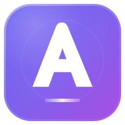
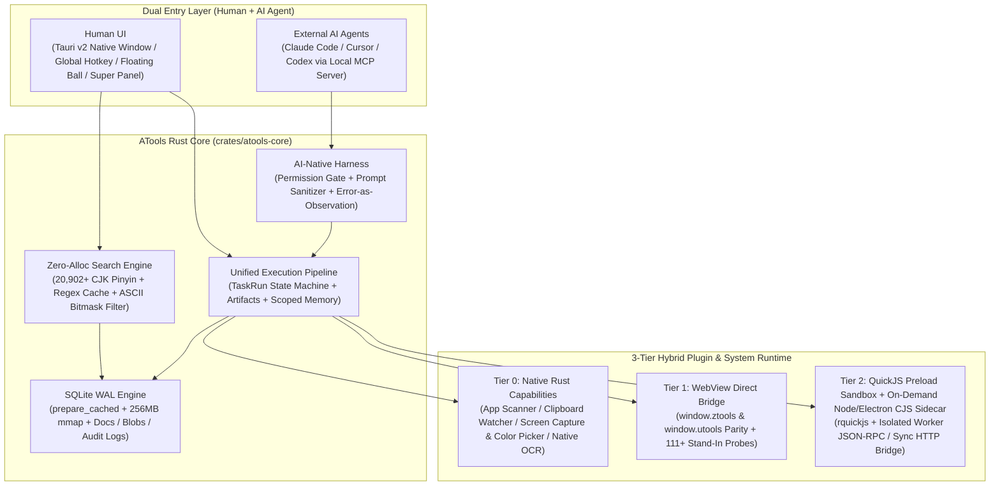

<div align="center">



# ATools 3.0

**Local-First AI-Native Desktop Launcher & Cross-Platform Plugin Runtime Built with Rust + Tauri v2**  
Seamless **uTools / ZTools** Ecosystem Compatibility · Zero-Alloc Sub-Millisecond Search · Native **MCP + Skills + Agent Harness**

[](https://github.com/TheLastSheep/atools/actions/workflows/ci.yml)
[](https://github.com/TheLastSheep/atools/actions/workflows/publish.yml)
[](https://github.com/TheLastSheep/atools/releases)
[](https://v2.tauri.app/)
[](https://www.rust-lang.org/)
[](./LICENSE)

[**简体中文**](./README.md) | [**English**](./README.en.md) | [**Architecture (DESIGN.md)**](./DESIGN.md) | [**Third-Party Notices**](./THIRD_PARTY_NOTICES.md)

</div>

---

## 1. Overview

**ATools 3.0** is a local-first desktop launcher, cross-platform plugin runtime, and AI-Native capability workspace built on **Rust + Tauri v2 + SQLite WAL**, featuring an embedded QuickJS sandbox and an on-demand Node.js compatibility runtime.

- **Extreme Rust Performance**: Zero-allocation ASCII matching, compile-time static Pinyin indexing across 20,902+ Unicode CJK characters, and a 100,000-entry search index with **`~0.1 ms`** P99 latency.
- **Dual-Namespace Plugin Compatibility**: First-class `window.utools` and `window.ztools` bidirectional API parity (125+ host API methods plus prototype-chain stand-in probes), running unmodified uTools/ZTools plugins alongside 40+ built-in workbench plugins.
- **AI-Native Workspace**: Built-in local **MCP (Model Context Protocol) Server**, **Skills Registry**, and **Agent Harness** with fine-grained permission gates, prompt sanitization, and full audit trails for Claude Code, Cursor, and Codex.
- **Local-First & Self-Hostable Sync**: All documents, clipboard history, settings, and plugin storage live in a local SQLite WAL database with optional AES-GCM encrypted WebDAV sync and a standalone Rust/Axum sync server (`atools-sync-server`).

---

## 2. Architecture



---

## 3. Quick Start

### Prerequisites

- **Rust**: `1.80+` (`cargo`, `rustfmt`, `clippy`)
- **Node.js**: `22+`
- **Package Manager**: `pnpm 11+`
- **Platform Toolchain**: Follow [Tauri v2 Prerequisites](https://v2.tauri.app/start/prerequisites/) for macOS, Windows, or Linux.

### Development & Build

```bash
# Install dependencies
pnpm install --frozen-lockfile

# Start desktop development mode
pnpm tauri dev

# Build production desktop bundles
pnpm build:ztools-updater
pnpm build
pnpm tauri build
```

### Verification & Benchmarks

```bash
pnpm check
pnpm test:unit
pnpm audit:host-api-surface
cargo fmt --all -- --check
cargo clippy --workspace --all-targets -- -D warnings
pnpm test:rust
pnpm benchmark:search:ci
```

---

## 4. License

Distributed under the [**MIT License**](./LICENSE). See [**THIRD_PARTY_NOTICES.md**](./THIRD_PARTY_NOTICES.md) for third-party attributions and upstream bundle licenses.
