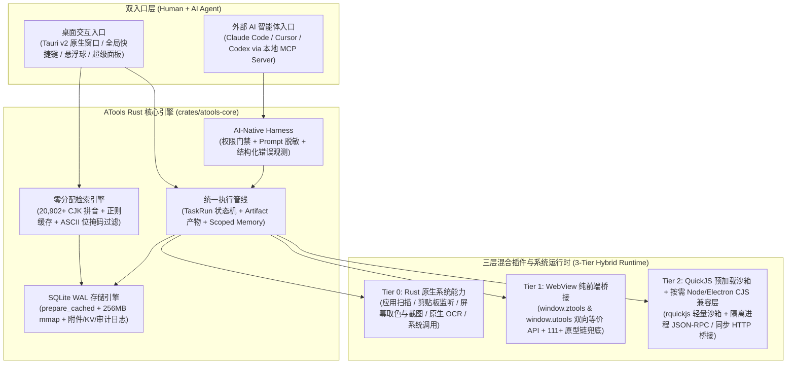

<div align="center">


# ATools 3.0

**基于 Rust + Tauri v2 的本地优先 AI-Native 桌面启动器与跨平台插件运行时**  
无缝兼容 **uTools / ZTools** 插件生态 · 零分配微秒级检索 · 原生 **MCP + Skills + Agent Harness**

[](https://github.com/TheLastSheep/atools/actions/workflows/ci.yml)
[](https://github.com/TheLastSheep/atools/actions/workflows/publish.yml)
[](https://github.com/TheLastSheep/atools/releases)
[](https://v2.tauri.app/)
[](https://www.rust-lang.org/)
[](./LICENSE)

[**简体中文**](./README.md) | [**English**](./README.en.md) | [**架构设计 (DESIGN.md)**](./DESIGN.md) | [**第三方开源声明**](./THIRD_PARTY_NOTICES.md)

</div>

---

## 一、项目简介

**ATools 3.0** 是一款面向开发者与高频效率用户的**本地优先（Local-First）桌面启动器、跨平台插件宿主与 AI-Native 能力工作台**。

相比基于重型 Chromium + 常驻 Node.js 主进程与 LevelDB/LMDB 的传统桌面工具箱，ATools 采用 **Rust 核心引擎 + Tauri v2 系统原生 WebView + SQLite WAL 嵌入式存储 + QuickJS 沙箱 + 按需（On-Demand）Node 兼容层** 构建：

- **极致性能**：零分配 ASCII 匹配、全量 Unicode CJK 汉字（20,902+）编译期静态拼音索引、十万级（100,000）指令集 P99 搜索延迟 **`~0.1 ms`**。
- **双命名空间生态兼容**：同时提供 `window.utools` 与 `window.ztools` 双向等价桥接（125+ 宿主 API 契约面 + 原型链兜底探针），支持直接导入并运行原版 uTools / ZTools 插件与内置 40+ 原生增强工作台插件。
- **AI-Native 双向赋能**：内置本地 **MCP（Model Context Protocol）服务端**、**Skills 技能编排** 与 **Agent Harness 安全围栏**，让 Claude Code、Cursor、Codex 等外部智能体可经过细粒度权限审批与脱敏审计调用桌面与插件能力。
- **数据主权与隐私优先**：所有文档、剪贴板历史、配置与插件数据默认保存在本地 SQLite WAL 数据库，支持 WebDAV 端到端加密同步与可选私有化部署的 Rust/Axum 同步服务（`atools-sync-server`）。

---

## 二、核心架构



---

## 三、核心特性矩阵

| 维度 | 核心能力说明 |
| :--- | :--- |
| **极速启动与检索** | 全局快捷键呼出、应用/文件/系统指令/网页快开/聚合计算检索；支持首字母拼音（如 `fygj`）、全拼（`fanyigongju`）、JS 正则字面量（`/pattern/flags`）与多模态剪贴板自动识别。 |
| **双生态插件兼容** | 完整实现 `window.utools` 与 `window.ztools` API 契约（`db` / `dbStorage` / `dbCryptoStorage`、`copyText` / `copyImage` / `copyFile`、`createBrowserWindow`、`ubrowser`、`ai`、`allAiModels`、动态 `setFeature`、子输入框 `setSubInput` 等）。 |
| **三层插件运行时** | **Tier 1** 纯 Web 插件直连 Tauri IPC；**Tier 2A** 纯 JS `preload.js` 运行于嵌入式 `rquickjs` 沙箱；**Tier 2B** 含 `require('fs'\|'child_process'\|'electron')` 的重度插件按需唤醒受控 Node 兼容工作进程并支持空闲回收。 |
| **40+ 内置精品插件** | 内置 JSON/数据工作台、颜色转换、剪贴板历史（Pasteboard Pro）、贴图截屏（Snipaste）、请求调试（HTTP/Webhook Lab）、密码/编解码、翻译、计算稿纸、二维码、待办事项、进程/启动项管理、文件/归档/Office/PDF/字幕工作台等。 |
| **AI-Native & MCP 治理** | 内置本地 MCP 服务端与一键生成客户端配置；支持细粒度权限策略（Allow / Confirm / Deny）、单次/会话级授权令牌、提示词脱敏（Prompt Sanitizer）与全链路审计日志。 |
| **跨平台原生集成** | 支持 **macOS**（`NSPanel` 无焦点浮层、原生 `NSWorkspace` 应用图标提取、Vision OCR、辅助功能联动）、**Windows**（Win32 窗口控制、句柄检索、注册表应用扫描）与 **Linux**（X11/Wayland 桌面适配）。 |
| **多端同步与自托管** | 支持本地数据导入导出、WebDAV 自动/手动同步（AES-GCM 加密），并提供独立 crate [`atools-sync-server`](./crates/atools-sync-server) 支持私有化部署同步服务。 |

---

## 四、性能基准对比

所列数据均由仓库内置 CI 性能门禁脚本（`pnpm benchmark:*:ci`）实测验证：

| 基准测试项 | 规模 / 场景 | CI 门禁阈值 | ATools 3.0 实测表现 |
| :--- | :--- | :---: | :---: |
| **十万级搜索索引 (`benchmark:search:ci`)** | `10,000` & `100,000` 指令集混合检索 | `P99 ≤ 16.0 ms` | **`P99 ≈ 0.106 ms`** |
| **Rust 核心特征匹配 (`FeatureSearchIndex`)** | `1,200` 插件特性 + 20,902 CJK 拼音 | `≤ 2.0 ms` | **`< 0.35 ms`** |
| **SQLite WAL 增长基准 (`benchmark:database:ci`)** | `10,000` & `100,000` 文档读写与前缀枚举 | `P99 ≤ 80.0 ms` | **`P99 < 15.0 ms`** |
| **剪贴板历史吞吐 (`benchmark:pasteboard:ci`)** | `10,000` & `100,000` 条剪贴板记录检索 | `P99 ≤ 150.0 ms` | **`P99 < 25.0 ms`** |

---

## 五、仓库目录结构

```text
atools/
├── crates/
│   ├── atools-core/          # Rust 核心引擎：零分配拼音/正则匹配、SQLite WAL、MCP Harness、TaskRun 管线
│   ├── atools-plugin/        # 插件加载器、兼容性分级器、QuickJS (rquickjs) 沙箱与权限校验
│   ├── atools-api-shim/      # uTools / ZTools 宿主 API 协议转换与 RPC 处理器
│   └── atools-sync-server/   # 可选私有化部署的 Rust/Axum 多端数据同步服务端
├── src-tauri/                # Tauri v2 桌面宿主：系统集成、多窗口编排、按需 Node 运行时与原生命令
├── src/                      # 桌面前端应用：启动器主面板、插件宿主容器、设置中心、双命名空间桥接库
├── packages/
│   ├── ztools-renderer/      # 锁定的 ZTools 兼容渲染层构建产物与溯源清单
│   ├── ztools-settings/      # 锁定的 ZTools 设置视图兼容包
│   └── ztools-updater/       # 锁定的 ZTools 更新器视图与宿主桥接包
├── resources/plugins/builtin/# 40+ 内置工作台插件与原生增强工具包
├── scripts/                  # 自动化验证、性能基准、宿主 API 审计与跨平台打包脚本
├── tests/                    # 460+ 组件/集成测试套件（近 4,000 条测试用例）
└── docs/                     # 架构决策记录 (ADR)、冒烟清单与演进规划文档
```

---

## 六、快速开始

### 1. 环境要求

- **Rust**：`1.80+`（推荐最新稳定版，`cargo` / `rustfmt` / `clippy`）
- **Node.js**：`22+`
- **包管理器**：`pnpm 11+`（可通过 `corepack enable` 启用）
- **系统依赖**：参考 [Tauri v2 官方先决条件](https://v2.tauri.app/start/prerequisites/) 安装对应操作系统的 WebView 与构建工具链。

### 2. 安装与开发调试

```bash
# 1. 克隆仓库
git clone https://github.com/TheLastSheep/atools.git
cd atools

# 2. 安装前端依赖
pnpm install --frozen-lockfile

# 3. 启动前端开发预览（浏览器模式）
pnpm dev

# 4. 启动 Tauri 桌面端完整开发模式
pnpm tauri dev
```

### 3. 构建与打包

```bash
# 构建前端与更新器静态产物
pnpm build:ztools-updater
pnpm build

# 构建当前平台 Tauri 桌面安装包 (.dmg / .app / .msi / .exe / .deb / .AppImage)
pnpm tauri build
```

---

## 七、质量门禁与测试验证

ATools 采用严格的分层自动化测试与性能门禁体系：

```bash
# 1. 前端与 Svelte/TypeScript 类型检查
pnpm check

# 2. 运行全量 Vitest 单元测试套件 (461 个测试文件 / ~4,000 条用例)
pnpm test:unit

# 3. 运行快速回归测试层与宿主 API 契约对账
pnpm test:fast
pnpm audit:host-api-surface

# 4. 运行 Rust 工作区格式、Clippy 静态检查与全量单元测试
cargo fmt --all -- --check
cargo clippy --workspace --all-targets -- -D warnings
pnpm test:rust

# 5. 运行十万级搜索、数据库与剪贴板性能基准门禁
pnpm benchmark:search:ci
pnpm benchmark:database:ci
pnpm benchmark:pasteboard:ci
```

---

## 八、CI/CD、版本发布与 GitHub Packages

仓库内置完整的 GitHub Actions 自动化流水线：

- **持续集成 ([`.github/workflows/ci.yml`](./.github/workflows/ci.yml))**：自动执行版本契约校验（`test:version-consistency`）、Rust Clippy/Test、前端类型检查、全量测试套件、性能基准门禁及 macOS / Linux / Windows 三端构建验证。
- **多端发布与包分发 ([`.github/workflows/publish.yml`](./.github/workflows/publish.yml))**：推送 `v*` 标签（如 `v3.0.0`）或手动触发时：
  1. 构建 **macOS Universal（Apple Silicon + Intel）**、**Windows x64**、**Linux x64** 安装包与签名更新清单 `latest.json`，自动发布至 **GitHub Releases**。
  2. 自动打包并发布 4 个 npm 兼容包至 **GitHub Packages**（`@thelastsheep/atools-ztools-renderer`、`@thelastsheep/atools-ztools-settings`、`@thelastsheep/atools-ztools-updater`、`@thelastsheep/atools-host-api-shim`）。

---

## 九、开源协议与致谢

- 本项目基于 [**MIT License**](./LICENSE) 开源协议发布。
- 项目中包含的第三方开源组件声明与上游兼容包许可证详见 [**THIRD_PARTY_NOTICES.md**](./THIRD_PARTY_NOTICES.md)。
- 感谢 [Tauri](https://tauri.app/)、[ZTools](https://github.com/ZToolsCenter/ZTools) 及其插件社区贡献者为桌面效率工具生态奠定的坚实基础。
